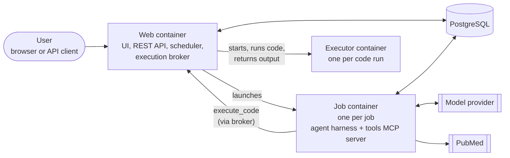
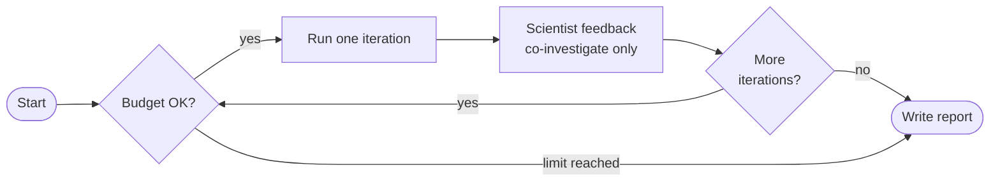

# Architecture

## What OpenScientist does

OpenScientist is an autonomous AI scientist. Given a research question and optional data files, it:

1. Explores the data to understand its structure
2. Searches PubMed for domain knowledge
3. Generates and tests hypotheses by writing and running analysis code
4. Records findings with supporting evidence and figures
5. Writes a final report synthesizing what it found

It runs for a set number of iterations, deciding for itself what to investigate next. In **co-investigate mode** it pauses after each iteration for guidance from a scientist.

## Design principles

- **Domain-agnostic.** Nothing is hard-coded for one field. It has been used on genomics, proteomics, structural biology, metabolomics, general tabular data, and literature-only questions. Domain knowledge comes from [skills](#skills).
- **Code-writing agent.** Instead of a fixed menu of statistical functions, the agent writes code for each analysis. It can invent analyses on the fly, and every line it runs is logged.
- **Literature-grounded.** The agent searches PubMed to inform hypotheses and interpret results, and cites what it read.

## Components

The web, job and executor boxes are separate Docker containers. PostgreSQL is a standard database service.

- **Web container** (`openscientist` service). The web interface, the [REST API](api.md), the job scheduler and the admin pages. It also runs the *execution broker*, Job containers have no Docker access, so every `execute_code` call goes to the broker, which starts an executor container, runs the code and returns the output. A compromised agent therefore cannot use Docker to reach the host.
- **PostgreSQL.** The database: jobs, users, the knowledge state, chat history, admin settings and spend. Each job container gets its own database login that can touch only its own job.
- **Job container.** Each job runs in its own short-lived container built from the agent image. Inside it, an **agent harness** drives the model and calls OpenScientist's tools through an MCP server.
- **Executor containers.** Each `execute_code` call runs in a fresh one-shot container with CPU, memory and time limits from the admin [Settings panel](getting-started.md#admin-settings).

In [air-gapped mode](airgap.md), executors have no network at all, the job container sits behind a default-deny firewall that only allows the database, the broker and the model endpoint, and PubMed is served from a local mirror.

## Agent harnesses

The harness is the agent loop that talks to the model and calls tools. OpenScientist supports three, chosen with `OPENSCIENTIST_HARNESS` (the setup wizard asks):

| Harness | Drives |
|---|---|
| `claude_code` | Claude models (Anthropic, Vertex, Bedrock, Foundry, CBORG) |
| `codex` | OpenAI models (OpenAI, Azure OpenAI) |
| `omp` | Any provider, including local models (Ollama, vLLM, llama.cpp) |

The default, `auto`, picks Claude Code for Claude providers, Codex for OpenAI providers and omp for everything else. See [Model Providers](getting-started.md#model-providers) for the providers themselves.

## The discovery loop

In each iteration the agent reads the knowledge state, decides what to investigate, runs code and searches the literature, then records its findings and a summary. In co-investigate mode it then waits for feedback, continuing on its own after 15 minutes.

Before every iteration the job checks the budget limits; if one is reached it stops and still writes its report from what it found. The report is HTML and PDF, with figures and references.

After a job finishes, you can **chat** with it: ask follow-up questions, and the agent can run more analyses with the same tools.

## Tools

The agent's tools, served by the `openscientist-tools` MCP server in the job container:

| Tool | Purpose |
|---|---|
| `execute_code` | Run Python (default), Rust or SPARQL in an executor container |
| `search_pubmed` | Search PubMed (or the local mirror when air-gapped) |
| `read_document` | Read an uploaded PDF, Word or Excel document |
| `update_knowledge_state` | Record a finding with its evidence |
| `add_hypothesis`, `update_hypothesis` | Track hypotheses and their status (when hypothesis tracking is on) |
| `save_iteration_summary` | Summarize what the iteration did |
| `set_job_title`, `set_status`, `set_consensus_answer` | Job bookkeeping |
| `run_phenix_tool`, `compare_structures`, `parse_alphafold_confidence` | Structural biology, when Phenix is installed |

## Skills

Skills are packages of instructions that guide the agent's reasoning. They are synced into the database from *skill sources* (Git repositories):

- **Built-in skills** in the [`skills/`](https://github.com/openscientist-io/openscientist/tree/main/skills) directory:
    - workflow: `hypothesis-generation`, `result-interpretation`, `prioritization`, `stopping-criteria`
    - domain: `genomics`, `metabolomics`, `data-science`, `structural_biology`, `phenix-tools-reference`, `berkeley-data-lakehouse`
- **Scientific Agent Skills** from K-Dense, a large community library: [K-Dense-AI/scientific-agent-skills](https://github.com/K-Dense-AI/scientific-agent-skills).

Admins can add more sources on the Skills page or through the [REST API](api.md) (`POST /skills/sources`).

## Provenance

Each run keeps:

- the full agent transcript for every iteration
- every piece of code executed, with its output
- the knowledge state: findings, evidence, hypotheses and literature
- all generated figures
- the run's environment (OpenScientist commit, harness and version, container), shown on the job page, in the report footer and as `provenance.json` in the artifacts zip

## Data formats

Tested with CSV, TSV, Excel, Parquet and JSON; PDB and mmCIF; FASTA; and PNG, JPG and TIFF images. The agent can usually work out other formats too. Data files are optional: a job can be literature-only.

## References

- [Model Context Protocol (MCP)](https://modelcontextprotocol.io/)
- [OpenScientist built-in skills](https://github.com/openscientist-io/openscientist/tree/main/skills)
- [K-Dense Scientific Agent Skills](https://github.com/K-Dense-AI/scientific-agent-skills)
